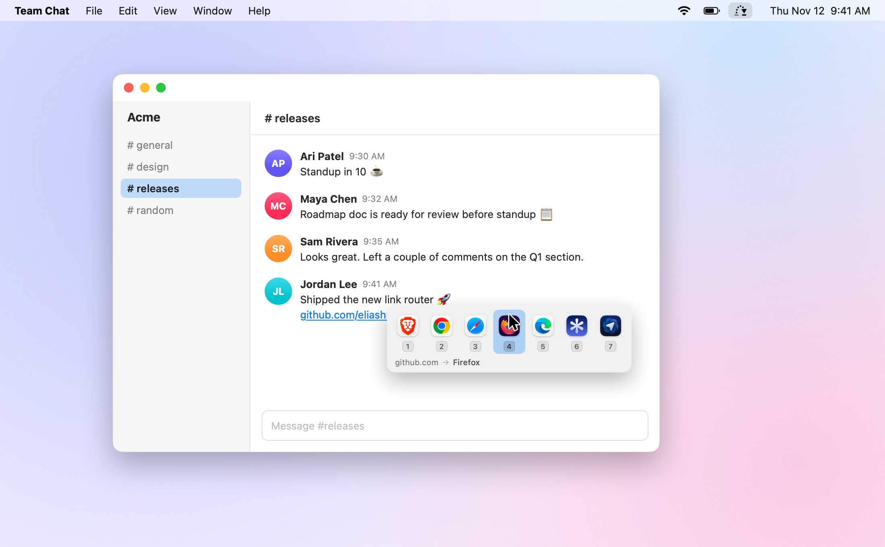
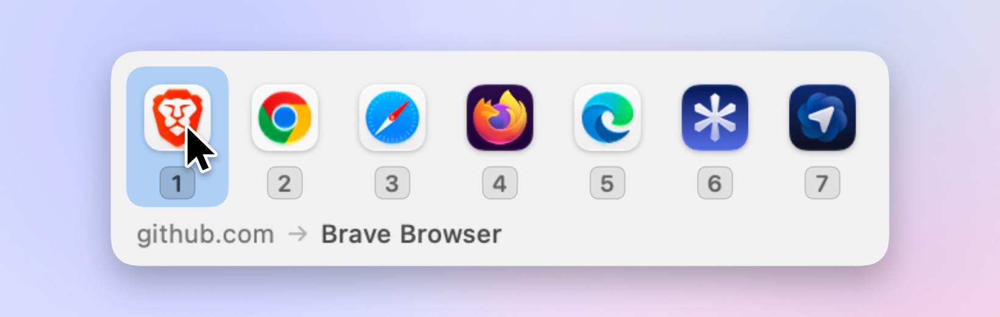
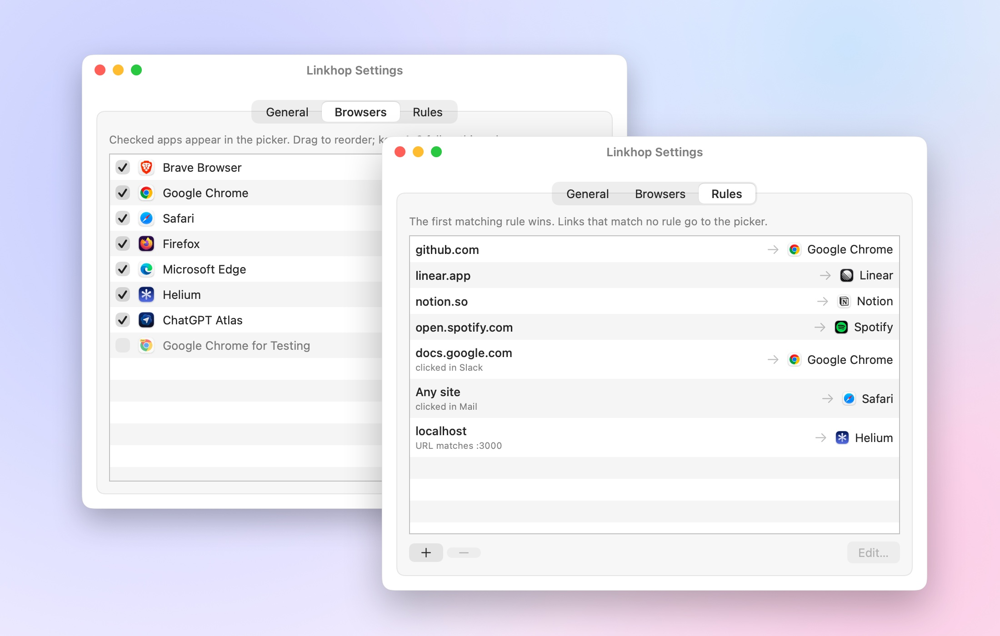

<div align="center">


# Linkhop

**Every link, to the right app.**

A tiny, native macOS link router. Set Linkhop as your default browser, and each link you click opens in the browser you want, chosen by your rules or from a small picker at your cursor.

[](https://github.com/eliashussary/linkhop/releases/latest)


[](LICENSE)

<br>

<picture>
  <source media="(prefers-color-scheme: dark)" srcset=".github/assets/hero-dark.jpg">
  
</picture>

</div>

---

## Features

- **Picker at your cursor.** A single row of browser icons appears where you clicked. Press `1`–`9`, use the arrow keys and `↩`, or click.
- **Rules.** Route links by site (`github.com`, `*.zoom.us`), by the app you clicked the link in (Slack, Mail, …), or by a URL regex.
- **One-key remember.** Hold `⌘` while picking to always open that site in that browser.
- **Native and small.** Written in Swift with AppKit and SwiftUI. The download is under 1 MB, it starts instantly, and it runs as a menu bar app with no Dock icon.
- **Private.** No network access, no analytics, no account. The log records only hosts, never full URLs.
- **Plain-text config.** Rules live in `~/.config/linkhop/config.json`, so you can keep them in your dotfiles. The Settings window edits the same file.

## Install

1. Download the latest **`Linkhop-x.y.z.dmg`** from [Releases](https://github.com/eliashussary/linkhop/releases/latest).
2. Open it and drag **Linkhop** into **Applications**.
3. Open Linkhop and click **Make Linkhop Default**. macOS asks you to confirm.

> [!NOTE]
> Releases aren't notarized by Apple yet, so macOS blocks Linkhop the first time you open it. Go to **System Settings → Privacy & Security** and click **Open Anyway**, or run:
>
> ```sh
> xattr -dr com.apple.quarantine /Applications/Linkhop.app
> ```

To uninstall, choose another default browser in **System Settings → Desktop & Dock → Default web browser**, then delete Linkhop from Applications.

## Using it

### Picker

<picture>
  <source media="(prefers-color-scheme: dark)" srcset=".github/assets/picker-dark.jpg">
  
</picture>

Each browser's number key is shown on the keycap underneath it.

| Key | Action |
| --- | --- |
| `1`–`9`, click, `↩` | Open in that app |
| `⌘` + any of the above | Open, and always use that app for this site |
| `←` `→` / `tab` | Move the selection |
| `esc`, click away | Cancel |

Hold `⌥` while clicking a link to always get the picker, skipping your rules.

### Settings

<picture>
  <source media="(prefers-color-scheme: dark)" srcset=".github/assets/settings-dark.jpg">
  
</picture>

Open Linkhop from Applications or Spotlight, or choose **Settings…** from the menu bar icon.

- **General:** default-browser status, and what to do when no rule matches (show the picker or always use one browser).
- **Browsers:** which apps appear in the picker. Drag to reorder them; keys 1–9 follow this order.
- **Rules:** add, edit, reorder and delete rules, choosing apps from menus.

### Config file

`~/.config/linkhop/config.json` is reread on every link, so edits take effect immediately.

```json
{
  "browsers": ["com.brave.Browser", "com.google.Chrome", "com.apple.Safari"],
  "fallback": "com.brave.Browser",
  "rules": [
    { "host": "github.com", "open": "com.google.Chrome" },
    { "host": "*.zoom.us", "pattern": "/j/", "open": "us.zoom.xos" },
    { "from": "com.tinyspeck.slackmacgap", "open": "com.apple.Safari" }
  ]
}
```

| Key | Meaning |
| --- | --- |
| `browsers` | Apps shown in the picker, in order. Leave it out to show every app that opens web links. |
| `fallback` | App to use when no rule matches. Leave it out to show the picker instead. |
| `rules` | Checked top to bottom; the first match wins. Every field you set must match. |
| `rules[].host` | Site to match. `github.com` also matches its subdomains, and `*` works as a glob. |
| `rules[].from` | Bundle ID of the app you clicked the link in. |
| `rules[].pattern` | Regex matched against the full URL. |
| `rules[].open` | Bundle ID of the app to open the link with. |

To find an app's bundle ID, run `osascript -e 'id of app "Slack"'`, or check `~/Library/Logs/Linkhop.log`, which records the app each link came from.

## Building from source

You need macOS 14 or later and the Xcode command line tools (`xcode-select --install`); Xcode itself isn't required.

```sh
git clone https://github.com/eliashussary/linkhop && cd linkhop
make install            # build, copy to /Applications, register and launch
make default            # make it the default browser
make dmg UNIVERSAL=1    # build a universal disk image in build/
```

| Path | What's there |
| --- | --- |
| `Sources/Linkhop/AppDelegate.swift` | Receiving links, routing, and menus |
| `Sources/Linkhop/Picker.swift` | The floating picker |
| `Sources/Linkhop/Settings.swift` | The Settings window |
| `Sources/Linkhop/Config.swift` | Rules, config file, and log |
| `scripts/make-icon.swift` | Draws the app icon (`make icon`) |
| `scripts/screenshots/` | Renders the README images from the real picker and settings views (`make screenshots`) |

## Releasing

Pushing a version tag builds a universal `.dmg` and publishes it to GitHub Releases:

```sh
git tag v0.2.0 && git push origin v0.2.0
```

For signed and notarized builds, add these repository secrets. The release workflow uses them automatically when they're present.

| Secret | Value |
| --- | --- |
| `MACOS_CERTIFICATE` | Base64-encoded Developer ID Application `.p12` |
| `MACOS_CERTIFICATE_PASSWORD` | Password for the `.p12` file |
| `APPLE_ID` | Your Apple ID email |
| `APPLE_TEAM_ID` | Your Apple Developer team ID |
| `APPLE_APP_PASSWORD` | An app-specific password for `notarytool` |

## License

[MIT](LICENSE) © Elias Hussary
